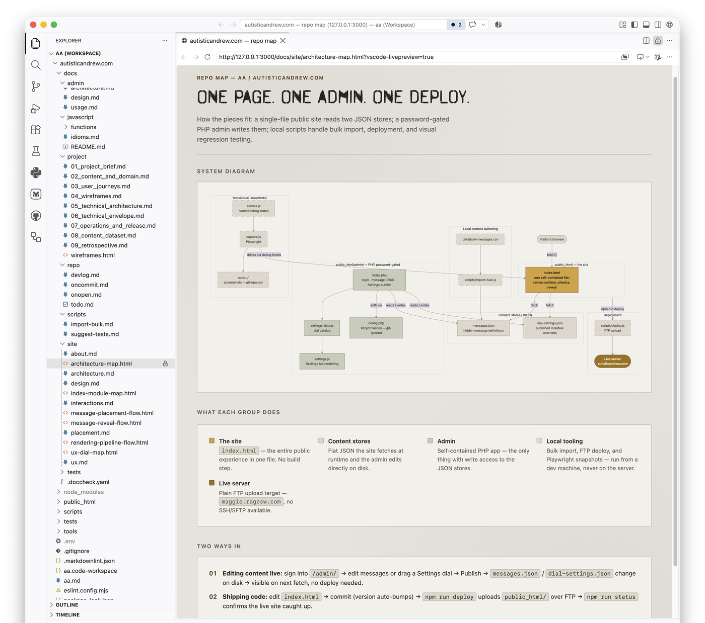

# Auto Artifact Preview

A VS Code extension that renders saved HTML artifacts in Live Preview the
moment you open them, instead of showing raw source — and closes the split
back down the moment you look away.



## Features

- **Auto-preview on open.** Open an `.html` file under a watched folder (a
  `docs/` tree by default) and it renders in Live Preview instead of showing
  source — no command to run, no click to make.
- **Auto-collapse on navigate-away.** The preview split closes itself once
  you switch to a different file, so it never lingers as a stale pane.
- **Configurable, not hardcoded.** Which folder names count, and whether
  auto-close happens at all, are both VS Code settings — see
  [Configuration](#configuration).

> Built for the workflow where generated HTML (e.g. a saved Claude Artifact)
> lives alongside the topic doc that references it — e.g.
> `docs/site/architecture-map.html` next to `docs/site/architecture.md` —
> rather than in one flat `docs/artifacts/` folder. Any `.html` file under a
> watched folder qualifies, wherever it's nested.

## Requirements

Requires the `ms-vscode.live-server` extension (Microsoft's "Live Preview"),
declared as an extension dependency — VS Code installs it automatically
alongside this one.

## Install

Not published to the Marketplace, so it's installed from a `.vsix` file:

```sh
cd vscode-extensions/auto-artifact-preview
npx --yes @vscode/vsce package --allow-missing-repository --skip-license
code --install-extension auto-artifact-preview-<version>.vsix
rm auto-artifact-preview-<version>.vsix
```

Then reload the window (`Cmd+Shift+P` → "Reload Window"). It's a per-machine
install — once installed, it's active in every workspace opened by that VS
Code install, with nothing to configure per-repo.

## Usage

Nothing to run — open any `.html` file under a watched folder and it
previews automatically. Switch to another file and the preview closes on its
own.

## Configuration

| Setting | Default | Description |
| --- | --- | --- |
| `autoArtifactPreview.docsFolderNames` | `["docs"]` | Folder names to watch. An HTML file auto-previews when one of these appears as a path segment anywhere in its path. |
| `autoArtifactPreview.autoClosePreview` | `true` | Auto-close the preview split on navigate-away. Set to `false` to leave it open until you close it yourself. |

## Development

Reinstall after editing `extension.js` or `package.json`:

```sh
cd vscode-extensions/auto-artifact-preview
npx --yes @vscode/vsce package --allow-missing-repository --skip-license
code --install-extension auto-artifact-preview-<version>.vsix
rm auto-artifact-preview-<version>.vsix
```

Bump `version` in `package.json` first if `code --install-extension` doesn't
pick up the change — a same-version reinstall isn't always honoured.

Uses the agency Oakroyd gold oakleaf (`icon.png`) as its Extensions-view
icon, so it reads at a glance as one of ours rather than a marketplace
install.

## License

[MIT](LICENSE)
